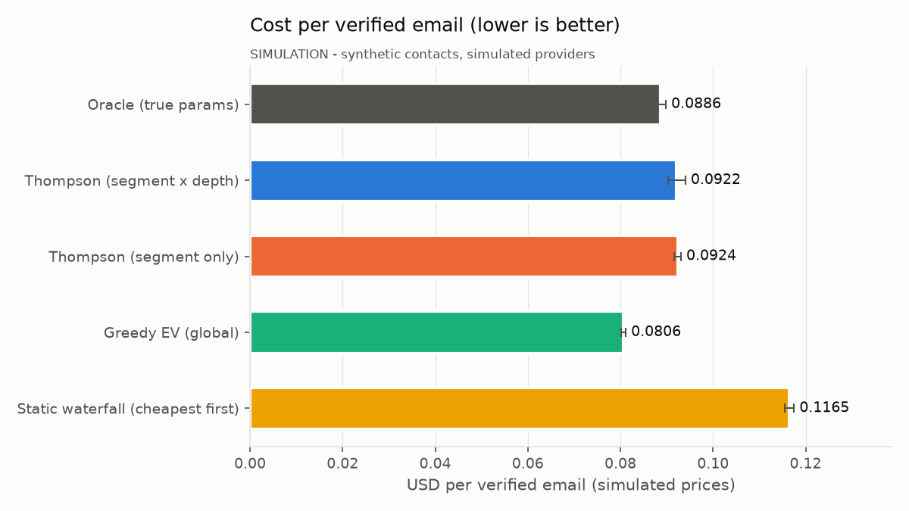
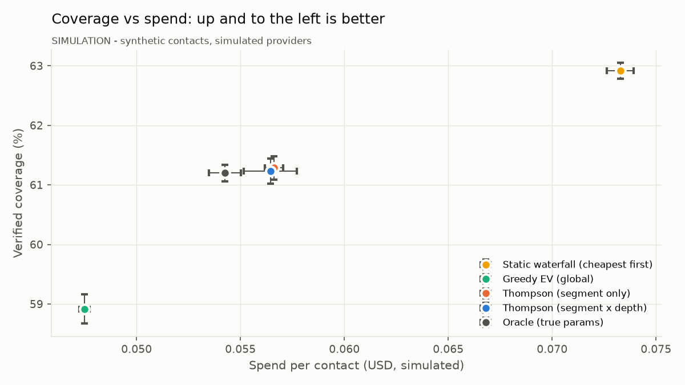
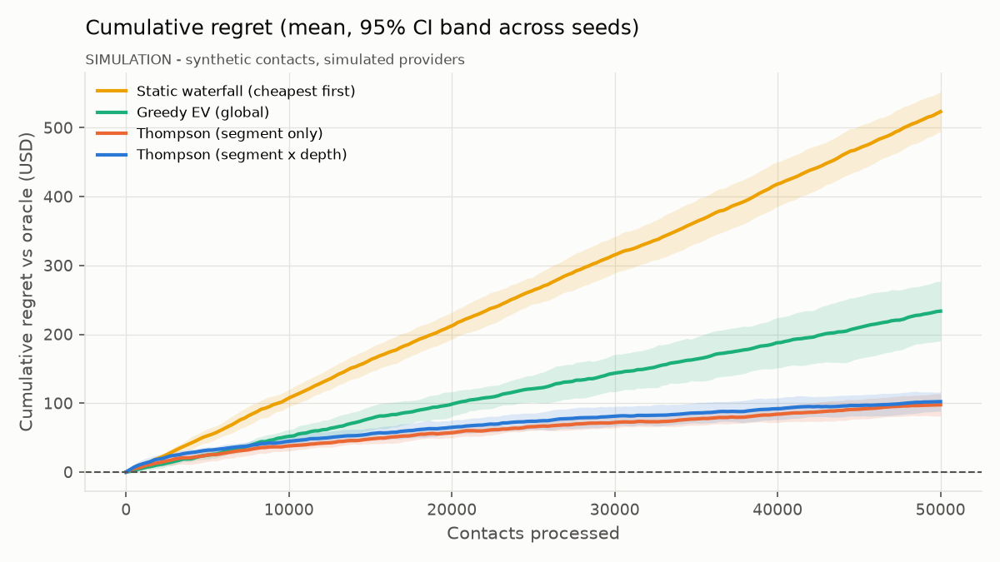
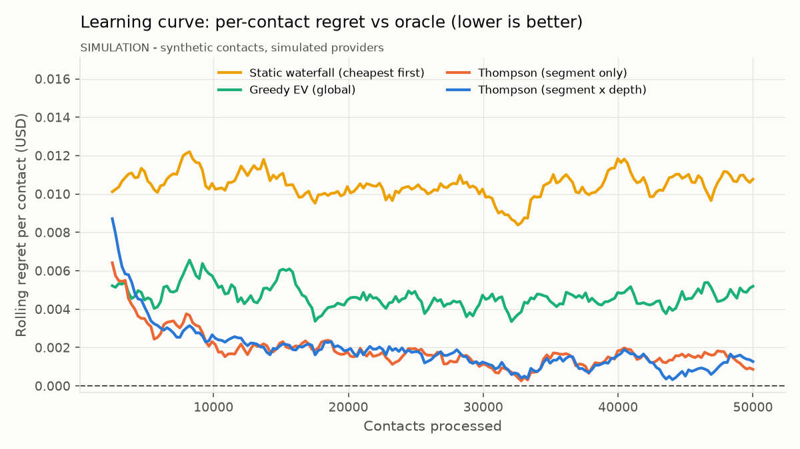

# waterfall-optimizer

**A self-hostable contact-enrichment orchestrator that learns which data provider to call
first for each segment, to minimise cost per *verified* email.** It is an open-source take
on "Clay-style waterfall enrichment" with a learning router (contextual Thompson sampling)
and a production-style reliability layer underneath.

[](.github/workflows/ci.yml)
 
 

> **Honesty note.** Every number in this README comes from the **simulation harness**
> (synthetic contacts with seeded ground truth and simulated providers). The prices, hit
> rates and latencies are illustrative. They are not production results and not benchmarks
> of Hunter, Apollo, Prospeo or Dropcontact. The live HTTP adapters exist and are unit-tested
> against mocked responses, but the router has not been run on real vendor traffic.

---

## 1. The problem: enrichment spend grows faster than pipeline

Outbound teams buy contact data from several vendors and chain them in a **waterfall**: try
vendor A, and if it misses, try B, then C. Most teams set the order once (usually cheapest
first) and never revisit it. That wastes money in three ways:

- **Wrong vendor first for the segment.** An EU-strong vendor might be the best first call
  for German SMB contacts and a waste of money for US enterprise ones. A single global order
  pays the cost of the miss on every contact where the first vendor is weak.
- **No stopping rule.** Static waterfalls keep calling until something is found, even when
  the 4th vendor's chance of finding a person the first three missed is too low to justify
  its price.
- **"Found" is not "verified".** A guessed `first.last@` at a catch-all domain looks like a
  hit and gets paid for, but it is not a deliverable contact.

On top of that comes operational risk: 429 storms, vendor outages, and retried jobs that
**pay twice for the same lookup**.

## 2. What I built

| Area | What is in the repo |
|---|---|
| Provider plugins | A `Provider` protocol. **Live HTTP adapters** for Hunter, Apollo and Prospeo, plus an async submit-and-poll adapter for Dropcontact-style APIs. Keys come from env only and are never logged. **Simulated providers** with segment-specific hit rate, accuracy, cost, latency distribution, 5xx rate and 429 rate |
| Learning router | Static waterfall (cheapest first), greedy expected value, and **contextual Thompson sampling** with Beta posteriors per provider x segment (country x size x seniority) x depth, a budget-aware stopping rule, expected-cost pricing for pay-per-hit vendors, and log-linear backoff priors |
| Verification | A verification step separates *found* from *verified* (valid / risky / catch-all / invalid). Only `valid` counts |
| Runtime | asyncio worker pool. **Durable SQLite-WAL job queue** with leases, visibility timeouts, fencing tokens, heartbeats, dead-lettering and crash recovery. An optional Postgres `SKIP LOCKED` backend behind the same interface |
| Reliability | Per-provider **token buckets**, **circuit breakers** (closed / open / half-open), **retries with exponential backoff and full jitter** (honouring `Retry-After`), a **TTL response cache**, a **cost ledger** with reservations and a hard budget, and **idempotency keys** for batches and charges |
| Interfaces | CLI `wfo run / simulate / report / generate / serve`. A **FastAPI** endpoint to submit a batch and poll it, with an Idempotency-Key header. An **HMAC-signed webhook** on completion |
| Evidence | A simulation harness (50k contacts x 5 seeds x 5 strategies x 2 scenarios), a Monte-Carlo oracle for regret, 95% CIs, matplotlib charts and a markdown report generated from `results.json` |
| Quality | Typed Python 3.11 (`mypy --strict` clean), ruff clean, **82 tests** including Hypothesis property and state-machine tests and fault-injection tests. Makefile, Dockerfile, GitHub Actions CI and 3 ADRs |

## 3. Architecture

```mermaid
flowchart LR
    subgraph Ingress
        CLI["wfo run (CSV)"]
        API["FastAPI POST /v1/batches<br/>Idempotency-Key"]
    end
    CLI --> Q
    API --> Q
    Q[("SQLite WAL job queue<br/>leases + fencing tokens<br/>(Postgres SKIP LOCKED optional)")]
    Q -->|lease / heartbeat| W["asyncio worker pool"]
    W --> P["Enrichment pipeline<br/>(per contact)"]
    P --> R{"Router<br/>static | greedy | Thompson"}
    R -->|next provider or STOP| C["Response cache (TTL)"]
    C -->|miss| L["Cost ledger<br/>reserve -> commit (idempotent)"]
    L --> B["Circuit breaker"]
    B --> T["Token bucket"]
    T --> X["Retry + backoff + jitter"]
    X --> V1["Hunter / Apollo / Prospeo / Dropcontact<br/>(HTTP adapters or simulated)"]
    V1 --> VER["Verifier<br/>valid / risky / catch-all / invalid"]
    VER -->|reward: verified?| R
    W -->|complete (fenced)| Q
    Q -->|batch finalized exactly once| WH["Signed webhook (HMAC)"]
    R -.posteriors persisted.-> S[("router_state")]
```

Per contact, the pipeline loops: *router picks a provider* -> *cache* -> *reserve budget* ->
*breaker* -> *rate limit* -> *call with retries* -> *commit actual charge* -> *cache write* ->
*verify* -> *feed the outcome back to the router*. It stops on `verified`, `catch_all`,
`router_stop` (no call has positive expected value), `budget`, or `exhausted`.

Code map: `src/wfo/{providers,reliability,queue,routing,sim}`, plus `pipeline.py`,
`worker.py`, `ledger.py`, `cache.py`, `api.py` and `cli.py`.

## 4. Bandit deep-dive

**Arms.** One arm per (segment, depth, provider). Segment = country (5) x company-size band
(3) x seniority (3) = 45 segments. *Depth* is the number of providers that have already
missed for this contact (0, 1, 2+). It is in the context because misses are correlated.

**Two posteriors per arm.** `theta ~ Beta`: P(call yields a **verified** email), which is
Thompson-sampled. `phi ~ Beta`: P(call returns any email), which is used to **price** the
call:

```
expected step cost  c = price * (1 if vendor charges on miss else phi) + phi * verify_cost
```

Pay-per-hit vendors are much cheaper per call than their list price. While building this,
the first bandit used list prices, systematically under-used a pay-per-hit vendor, and lost
to a simple baseline. Adding `phi` fixed that.

**Decision rule** (per step of the waterfall):

1. The candidates are providers whose breaker is available, that have not been tried yet,
   and whose price fits in `min(per-contact cap remaining, global ledger remaining)`.
2. Sample `theta_i` for each candidate and drop any with sampled net value
   `theta_i * V - c_i < 0`. This is the **budget-aware stopping rule**. V is what a verified
   email is worth to you (default $0.50).
3. Call `argmax theta_i / c_i`, the optimal index for sequential search, or stop if there are
   no candidates left.

**Cold start without waiting forever.** There are 540 arms, and a rare segment
(FR x 501+ x exec) is about 0.3% of traffic. Each arm's Beta prior is an empirical-Bayes
**log-linear backoff**: per-dimension pooled rates, shrunk toward the provider's global rate,
combined in logit space:

```
logit(m0) = logit(m_country) + logit(m_size) + logit(m_seniority) - 2 * logit(m_global)
prior     = Beta(1 + k*m0, 1 + k*(1-m0)),   k = min(n_global, 20)
```

A segment the router has never seen still gets a sensible prior from its country, size and
seniority. A test checks exactly this.

**What "regret" means here.** The waterfall continues only after a miss, so any policy that
conditions on (segment, providers tried) *is* an ordered provider sequence per segment. The
**oracle** enumerates all 65 ordered subsets of the 4 providers (including "call nobody")
under the **true** simulated parameters and picks the best per segment (Monte-Carlo, 4,000
draws per segment). Regret = oracle net value - strategy net value, on the *same* contacts
and *same* provider outcomes (common random numbers).

Design trade-offs (UCB vs TS, logistic-regression TS, censoring of errors, catch-all
handling) are in [ADR 0002](docs/adr/0002-contextual-thompson-sampling-router.md).

## 5. Simulation results (SIMULATION, not production)

Setup: **50,000 synthetic contacts per run x 5 seeds** (each seed = new world parameters, new
contacts, new stream order) x 5 strategies x 2 scenarios. That is 2.5M enrichments through
the real pipeline (cache, ledger, breakers, buckets, retries, verifier) on a virtual clock,
in 439s on 2 cores. V = $0.50. ± = 95% Student-t interval across seeds. Full report:
[`docs/results/report.md`](docs/results/report.md). Raw numbers:
[`docs/results/results.json`](docs/results/results.json).

| Strategy | Cost / verified | Verified coverage | Spend / contact | Net value / contact | p95 latency | Regret vs oracle (50k) |
|---|---|---|---|---|---|---|
| Static waterfall (cheapest first) | $0.1165 ± 0.0010 | 62.9 ± 0.1% | $0.0733 | $0.2413 | 6.19 s | $523 ± 29 |
| Greedy EV (global rates) | **$0.0806** ± 0.0005 | 58.9 ± 0.2% | $0.0475 | $0.2471 | 3.59 s | $234 ± 43 |
| Thompson (segment only) | $0.0924 ± 0.0007 | 61.3 ± 0.2% | $0.0566 | $0.2498 | 5.09 s | **$98 ± 16** |
| Thompson (segment x depth) | $0.0922 ± 0.0019 | 61.2 ± 0.2% | $0.0564 | $0.2497 | 5.06 s | $102 ± 14 |
| Oracle (true parameters) | $0.0886 ± 0.0012 | 61.2 ± 0.1% | $0.0542 | $0.2518 | 4.74 s | 0 |

**What the numbers say:**

- **Against the static waterfall, the Thompson router cut cost per verified email by 20.9%
  and spend per contact by 23.0%** ($0.0733 -> $0.0564), at **-1.68 pp** verified coverage.
  It deliberately skips the last ~2% of verified emails, because at V = $0.50 they cost more
  to find than they are worth. Scaled to 100k contacts: $7,328 -> $5,644 in simulated spend,
  62,916 -> 61,232 verified emails, net value $24,130 -> $24,972.
- **It closes 80% of the static-to-oracle gap** (cumulative regret $102 vs $523 over 50k
  contacts). Its learned first provider matches the oracle's in **83 ± 7%** of segments.
- **Greedy has the lowest cost per verified email but is not the best strategy.** It gets
  there by giving up 4 pp of coverage, and its regret keeps growing linearly (chart below).
  Cost per verified email alone is a misleading KPI, so the objective here is net value.
- **Honest negative result:** the depth-aware variant is statistically indistinguishable from
  segment-only Thompson in this world. It is kept as an ablation, not claimed as a win.
- **p95 latency fell by 18.4%** vs static (6.19 s -> 5.06 s), because fewer wasted calls
  were made before the hit.






**Fault scenario (also simulated): hard outage of one provider for 10,000 contacts (30%-50%
of the stream).** Breakers opened, routers skipped the provider, and half-open probes (one
every 30 s of virtual time) detected recovery. For the static waterfall, about 860
breaker-open cycles per run replaced roughly 10,000 doomed first calls (each of which would
have retried 4 times). Verified coverage moved by only -0.8 pp (static) and -0.9 pp
(Thompson) over the whole run, and failed calls cost $0 because the ledger only charges
successful responses. See the second table in the [report](docs/results/report.md).

## 6. Reliability design

Full rationale is in [ADR 0001](docs/adr/0001-sqlite-wal-lease-queue.md) (queue) and
[ADR 0003](docs/adr/0003-reliability-envelope-and-cost-safety.md) (cost safety).

- **At-least-once delivery, exactly-once effects.** Leases with visibility timeouts and
  heartbeats. *Fencing tokens* make a zombie worker's late `complete()` a no-op. Charges are
  idempotent on `batch:contact:provider`, and the response cache is written *before* the
  ledger commit, so a recovered job is served from cache instead of paying again.
- **Spend can never exceed the budget.** Every call reserves its maximum price inside
  `BEGIN IMMEDIATE`. Amounts are integer micro-dollars. Reservations are released on errors
  *and* on cancellation; holds left by crashed processes are reclaimed by `release_stale()`.
- **Outages turn into routing, not errors.** An open breaker removes the provider from the
  router's candidate set. 429s drain the token bucket and back off with full jitter that is
  never shorter than `Retry-After`.

**How it is tested** (82 tests, `pytest` ~11 s):

| Test | Kind |
|---|---|
| Ledger never exceeds budget for any sequence of reserve/commit/release, replays and over-charges | Hypothesis property |
| A job is never leased to two workers at once, completed jobs never re-lease, only the current holder can ack | Hypothesis **state machine** (4 workers, random clock jumps) |
| Token bucket never grants more than `capacity + rate x elapsed` | Hypothesis property. **It found a real bug**: float rounding made the bucket re-wait 1e-17 s forever on the virtual clock |
| Backoff stays within `[0, min(cap, base*2^n)]` and respects `Retry-After` | Hypothesis property |
| Provider outage, breaker recovery via half-open probe, 429 storm, transient 429s charged once, all providers down | Fault injection |
| **Worker crash after paying, before acking**: job re-leased after timeout, served from cache, one charge, zombie ack rejected | Fault injection |
| Cancellation mid-call releases the budget hold; pipeline exceptions requeue then dead-letter | Fault injection |
| 6 threads with separate SQLite connections drain 300 jobs with no job processed twice | Concurrency |
| HTTP adapters: 429 + `Retry-After`, 401 non-retryable, 5xx, transport errors, Dropcontact polling; keys never in `repr` | `httpx.MockTransport` |
| API: submit, idempotent resubmit, poll, results, signed webhook, router state persisted across restarts | FastAPI TestClient |

## 7. Quickstart

```bash
make install                  # python3.11 venv + dev deps
make check                    # ruff + mypy --strict + pytest

# Enrich a CSV in simulated mode (no keys needed)
.venv/bin/wfo generate --n 500 --out contacts.csv
.venv/bin/wfo run --input contacts.csv --output enriched.csv --strategy thompson --budget 50

# Reproduce the README numbers (about 7 minutes on 2 cores) and re-render the report
make simulate
make report

# API + workers
.venv/bin/wfo serve --port 8000
curl -X POST localhost:8000/v1/batches -H 'Content-Type: application/json' \
     -H 'Idempotency-Key: crm-export-2026-11-19' \
     -d '{"strategy":"thompson","webhook_url":"https://example.com/hook",
          "contacts":[{"id":"1","first_name":"Ada","last_name":"Lovelace",
                       "company_domain":"example.com","country":"UK",
                       "employees":40,"seniority":"exec"}]}'
curl localhost:8000/v1/batches/<batch_id>
curl localhost:8000/v1/batches/<batch_id>/results

# Docker
docker build -t waterfall-optimizer . && docker run -p 8000:8000 -v wfo:/data waterfall-optimizer
```

**Live mode:** copy `.env.example` to `.env`, set `WFO_MODE=live` and any of
`HUNTER_API_KEY`, `APOLLO_API_KEY`, `PROSPEO_API_KEY` or `DROPCONTACT_API_KEY`. An adapter is
enabled only for keys that are set. Verify the endpoints and pricing against each vendor's
current docs and your contract first. The webhook signature is
`X-WFO-Signature: sha256=<hmac(body)>`, using `WFO_WEBHOOK_SECRET`.

## 8. Limitations

- **A simulation is not production data.** The synthetic world was *designed* with
  segment-dependent vendor strengths. If real vendors are uniform across segments, there is
  little for a contextual router to learn, and the gap to a static waterfall shrinks. The
  results show the mechanism works when that structure exists; they do not prove the
  structure exists for your data.
- In the simulation, provider outcomes are independent given the contact's latent "is
  discoverable" and "catch-all" flags. Real vendors share data sources, so their misses
  correlate more strongly.
- "Verified" in live mode relies on the vendor's own status field unless you plug in a
  dedicated verifier through the `Verifier` protocol.
- The router assumes stationarity. Vendor quality drifts, and the posteriors do not forget.
- There is a residual double-charge window if a process dies between the vendor's response
  and the local cache write (ADR 0003).
- The Postgres backend is implemented but only runs in tests when `WFO_PG_DSN` is set; it is
  not in default CI.
- The live adapters were tested against mocked responses, not against real vendor accounts.

## 9. Roadmap

1. Shadow mode: run the bandit beside an existing Clay/static waterfall and report
   counterfactual savings before letting it route.
2. Discounted posteriors or a sliding window for vendor drift, and change-point alerts.
3. A dedicated verifier adapter (ZeroBounce / NeverBounce) and verifier-cost-aware stopping.
4. Bayesian logistic-regression Thompson sampling for richer context (industry, title
   keywords) once there is enough traffic.
5. A per-campaign value V (an enterprise AE's contact is worth more than an SMB one) and
   budget pacing across a month.
6. An OpenTelemetry trace per contact; Prometheus metrics for spend, breaker state and
   regret proxies.
7. A Postgres backend in CI via a service container; horizontal workers.

---

MIT (c) 2026 Hussain Singapuri. Simulated provider parameters are illustrative and
deliberately not tied to any real vendor's pricing or performance.
