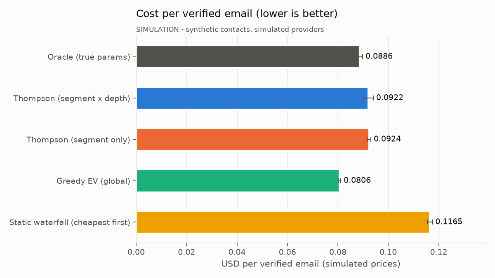
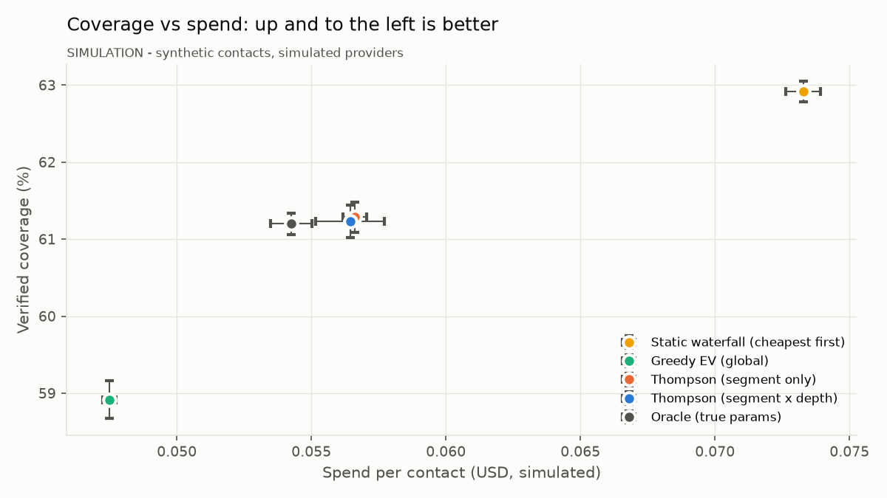
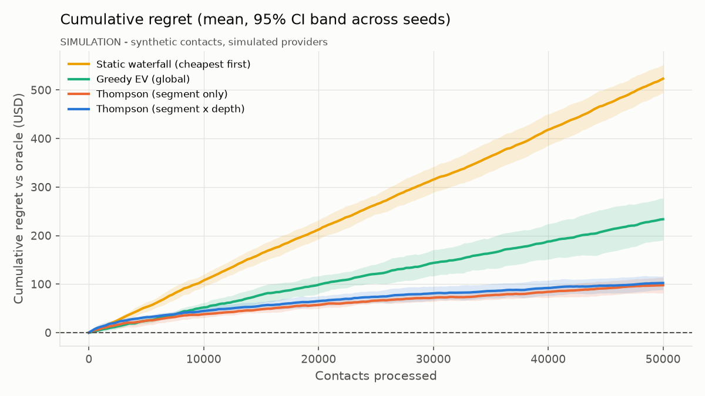
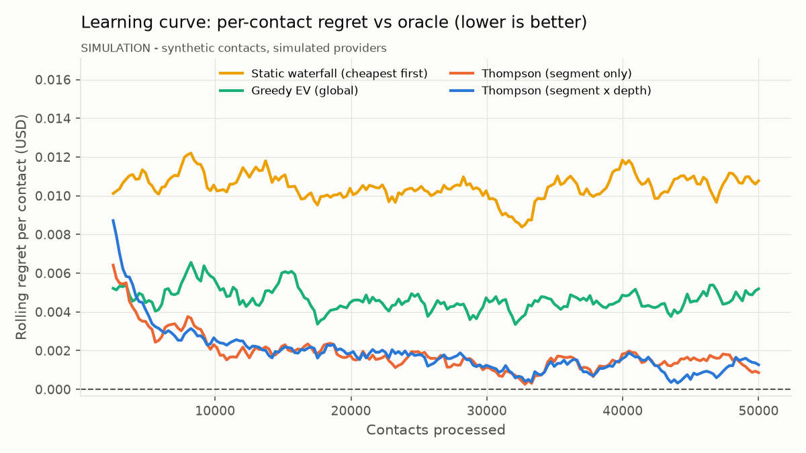
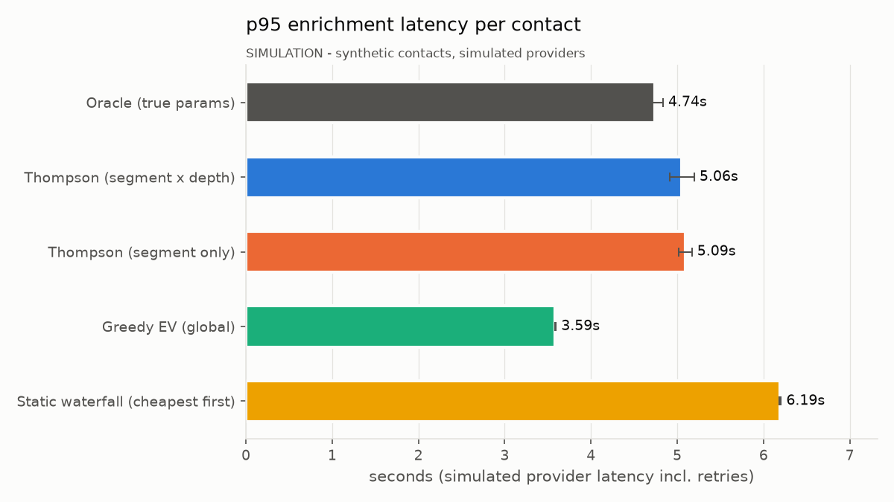

# Simulation report: waterfall-optimizer

> **SIMULATION ONLY.** Synthetic contacts with seeded ground truth and simulated providers whose prices, hit rates, latencies and error rates are illustrative. These are not production results and not benchmarks of any real vendor.

## Setup

- Contacts per run: **50,000**; seeds: **[1, 2, 3, 4, 5]** (each seed = new world parameters, new contacts, new stream order)
- Value of a verified email V = **$0.50**; per-contact spend cap **$0.30**; global budget: none
- Every strategy runs through the same production pipeline (cache, ledger, token buckets, circuit breakers, retries with jitter, verifier) on a virtual clock, and sees the same contacts and the same provider outcomes (common random numbers).
- Oracle = best fixed provider sequence per segment under the TRUE parameters (Monte-Carlo, 4,000 draws x 65 sequences x 45 segments).
- Intervals are 95% Student-t intervals across seeds. *Precision = share of 'verified' emails that match ground truth.
- Total harness wall-clock: 439s.

## Baseline scenario

| Strategy | Cost / verified (USD) | Verified coverage | Found rate | Precision* | Spend / contact | Net value / contact | p95 latency (s) | Calls / contact | Final regret (USD) |
|---|---|---|---|---|---|---|---|---|---|
| Static waterfall (cheapest first) | 0.1165 ± 0.0010 | 62.9 ± 0.1% | 82.8 ± 0.2% | 99.74 ± 0.04% | 0.0733 ± 0.0006 | 0.2413 ± 0.0009 | 6.19 ± 0.01 | 2.35 ± 0.02 | 523.4 ± 28.9 |
| Greedy EV (global) | 0.0806 ± 0.0005 | 58.9 ± 0.2% | 78.6 ± 0.1% | 99.77 ± 0.04% | 0.0475 ± 0.0003 | 0.2471 ± 0.0012 | 3.59 ± 0.01 | 2.01 ± 0.01 | 233.7 ± 43.1 |
| Thompson (segment only) | 0.0924 ± 0.0007 | 61.3 ± 0.2% | 81.1 ± 0.1% | 99.76 ± 0.04% | 0.0566 ± 0.0004 | 0.2498 ± 0.0009 | 5.09 ± 0.07 | 2.07 ± 0.02 | 97.7 ± 16.1 |
| Thompson (segment x depth) | 0.0922 ± 0.0019 | 61.2 ± 0.2% | 81.1 ± 0.4% | 99.76 ± 0.05% | 0.0564 ± 0.0013 | 0.2497 ± 0.0008 | 5.06 ± 0.14 | 2.07 ± 0.02 | 102.3 ± 14.1 |
| Oracle (true params) | 0.0886 ± 0.0012 | 61.2 ± 0.1% | 81.0 ± 0.2% | 99.75 ± 0.05% | 0.0542 ± 0.0008 | 0.2518 ± 0.0007 | 4.74 ± 0.10 | 1.99 ± 0.02 | 0 (reference) |

### Headline comparisons (Thompson segment x depth vs static waterfall)

- Cost per verified email: **20.9% lower**
- Verified coverage change: **-1.68 percentage points**
- Spend per contact: **23.0% lower**
- p95 latency: **18.4% lower**
- Cumulative regret vs oracle: **80% lower** than static (equivalently: that share of the static-to-oracle net-value gap is closed)
- Segments where the learned first provider equals the oracle's: **83 ± 7%**

## Fault scenario: hard outage of `apollo` for contacts 30%-50% of the stream

Circuit breakers open, routers skip the provider, half-open probes detect recovery.

| Strategy | Cost / verified (USD) | Verified coverage | Found rate | Precision* | Spend / contact | Net value / contact | p95 latency (s) | Calls / contact | Final regret (USD) |
|---|---|---|---|---|---|---|---|---|---|
| Static waterfall (cheapest first) | 0.1183 ± 0.0006 | 62.1 ± 0.2% | 81.7 ± 0.2% | 99.75 ± 0.04% | 0.0735 ± 0.0004 | 0.2371 ± 0.0008 | 6.17 ± 0.01 | 2.29 ± 0.01 | 470.8 ± 22.2 |
| Greedy EV (global) | 0.0808 ± 0.0005 | 57.5 ± 0.3% | 76.7 ± 0.2% | 99.77 ± 0.04% | 0.0465 ± 0.0002 | 0.2412 ± 0.0015 | 3.55 ± 0.01 | 1.94 ± 0.01 | 266.4 ± 45.1 |
| Thompson (segment only) | 0.0948 ± 0.0003 | 60.4 ± 0.2% | 79.9 ± 0.1% | 99.78 ± 0.04% | 0.0572 ± 0.0003 | 0.2448 ± 0.0008 | 5.17 ± 0.06 | 2.03 ± 0.02 | 85.4 ± 11.9 |
| Thompson (segment x depth) | 0.0945 ± 0.0023 | 60.3 ± 0.3% | 79.8 ± 0.4% | 99.77 ± 0.04% | 0.0570 ± 0.0016 | 0.2445 ± 0.0009 | 5.14 ± 0.15 | 2.02 ± 0.02 | 98.3 ± 13.2 |
| Oracle (true params) | 0.0897 ± 0.0011 | 60.1 ± 0.2% | 79.5 ± 0.2% | 99.77 ± 0.04% | 0.0539 ± 0.0007 | 0.2465 ± 0.0008 | 4.73 ± 0.09 | 1.94 ± 0.02 | 0 (reference) |

## Charts

## Reading these results

- `thompson` (segment x depth) and `thompson-flat` (segment only) are statistically indistinguishable here: in this world the depth context did not pay for its extra arms. It is kept as an ablation, not claimed as a win.
- The objective is **net value = V x verified - spend**, not raw cost per verified. A router that calls only the single best provider gets a low cost per verified email by giving up coverage; the table shows both so that trade-off is visible.
- The synthetic world was designed with segment-dependent provider strengths. If real vendors were uniform across segments, a contextual router would have little to learn and the gap to a static waterfall would shrink.
