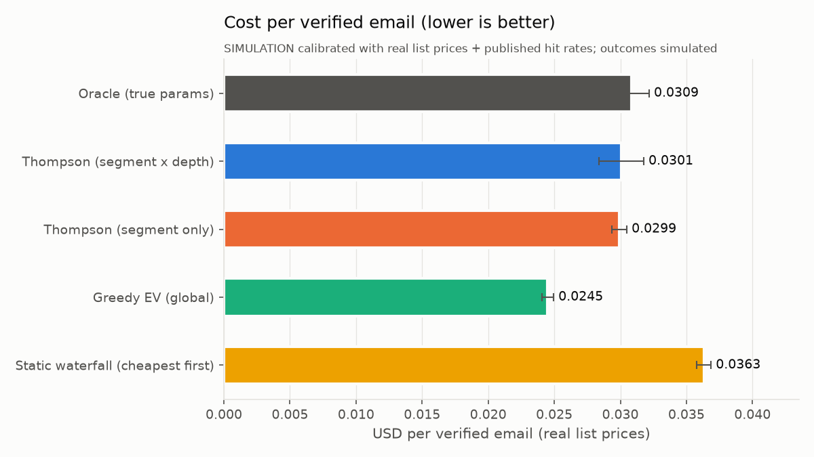
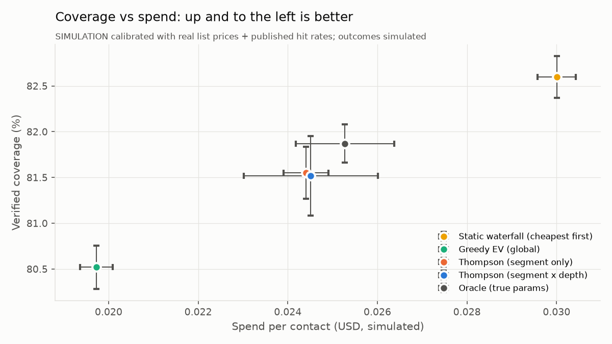
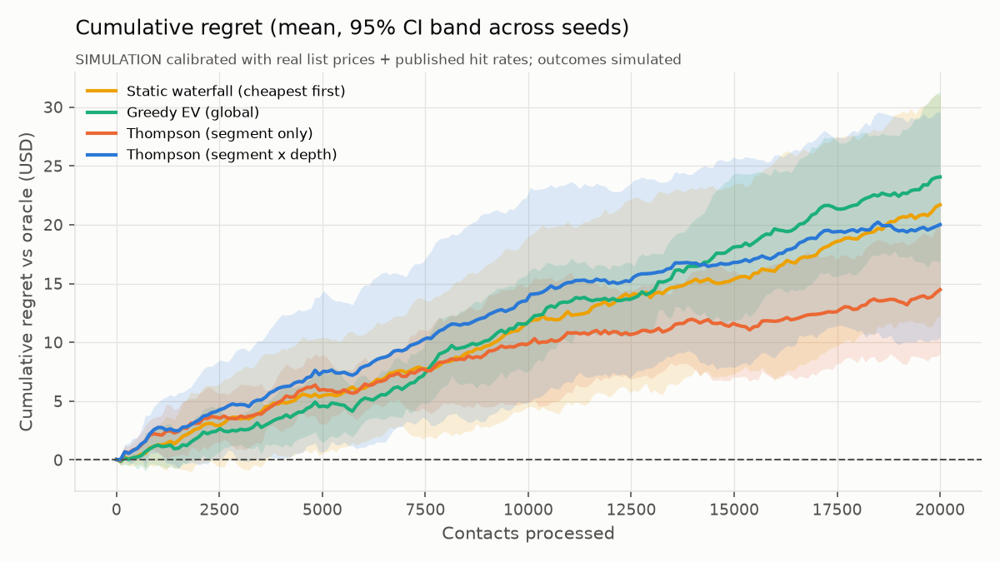
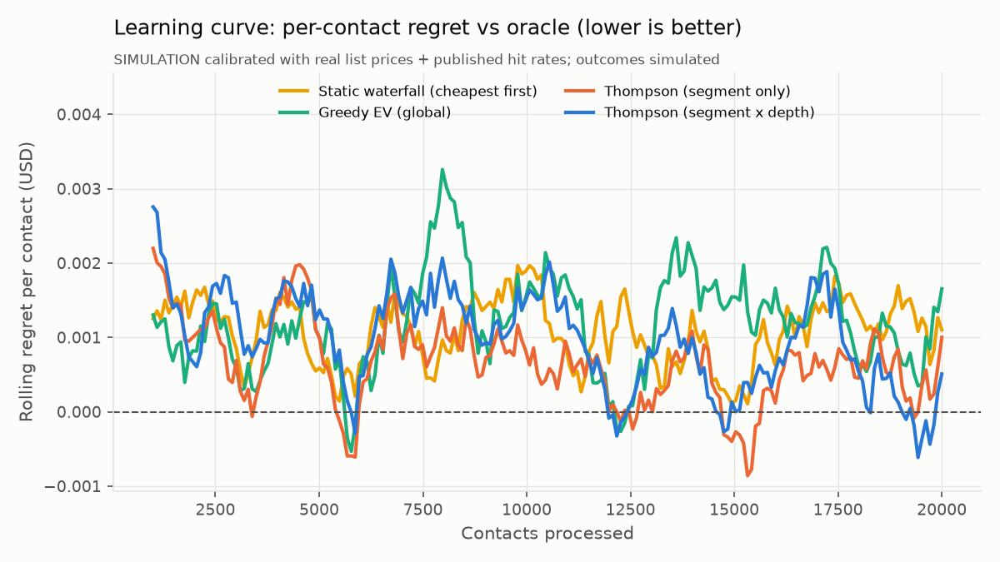
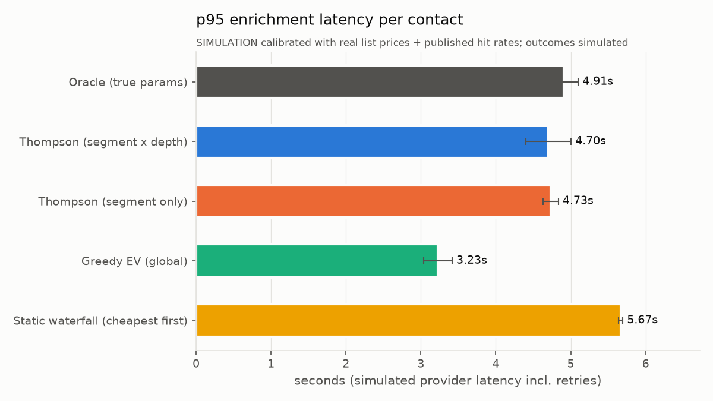
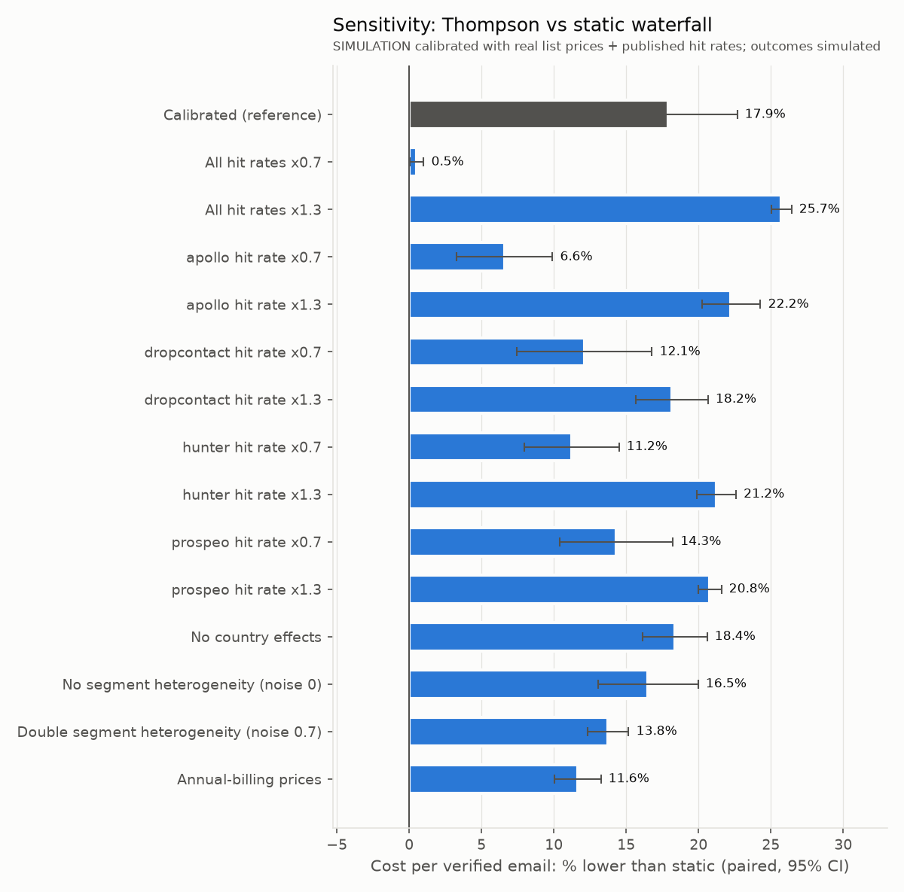

# Simulation report: waterfall-optimizer (real-calibrated world)

> **SIMULATION, CALIBRATED WITH REAL PUBLIC INPUTS.** Provider prices are public list prices (accessed 2026-11-20); hit and accuracy rates are fitted to published, vendor-run benchmarks. Contacts and provider outcomes are still simulated, latencies and error rates are illustrative, and no live vendor traffic was used.

## Calibration inputs

From `configs/real_calibrated.json` (sources accessed 2026-11-20; full citations in `docs/real_calibration_sources.md`). Hit rate / accuracy are the world-model parameters solved from the benchmark's found and valid rates; P(email discoverable at all) = 0.858; verification cost $0.000; segment noise 0.35.

| Provider | USD per email (list) | Charged on miss | Hit rate (model) | Accuracy (model) | Price source |
|---|---|---|---|---|---|
| apollo | $0.0196 | no | 0.849 | 0.964 | https://www.apollo.io/pricing |
| dropcontact | $0.1737 | no | 0.848 | 0.983 | https://www.dropcontact.com/pricing |
| hunter | $0.0245 | no | 0.762 | 0.908 | https://hunter.io/pricing |
| prospeo | $0.0245 | no | 0.556 | 0.977 | https://prospeo.io/pricing |

## Setup

- Contacts per run: **20,000**; seeds: **[1, 2, 3, 4, 5]** (each seed = new world parameters, new contacts, new stream order)
- Value of a verified email V = **$0.50**; per-contact spend cap **$0.30**; global budget: none
- Every strategy runs through the same production pipeline (cache, ledger, token buckets, circuit breakers, retries with jitter, verifier) on a virtual clock, and sees the same contacts and the same provider outcomes (common random numbers).
- Oracle = best fixed provider sequence per segment under the TRUE parameters (Monte-Carlo, 4,000 draws x 65 sequences x 45 segments).
- Intervals are 95% Student-t intervals across seeds. *Precision = share of 'verified' emails that match ground truth.
- Total harness wall-clock: 205s.

## Baseline scenario

| Strategy | Cost / verified (USD) | Verified coverage | Found rate | Precision* | Spend / contact | Net value / contact | p95 latency (s) | Calls / contact | Final regret (USD) |
|---|---|---|---|---|---|---|---|---|---|
| Static waterfall (cheapest first) | 0.0363 ± 0.0005 | 82.6 ± 0.2% | 90.6 ± 0.2% | 99.90 ± 0.01% | 0.0300 ± 0.0004 | 0.3830 ± 0.0013 | 5.67 ± 0.03 | 1.75 ± 0.02 | 21.7 ± 9.3 |
| Greedy EV (global) | 0.0245 ± 0.0004 | 80.5 ± 0.2% | 87.9 ± 0.2% | 99.91 ± 0.01% | 0.0197 ± 0.0004 | 0.3829 ± 0.0012 | 3.23 ± 0.19 | 1.57 ± 0.02 | 24.1 ± 7.2 |
| Thompson (segment only) | 0.0299 ± 0.0006 | 81.6 ± 0.3% | 89.2 ± 0.3% | 99.90 ± 0.01% | 0.0244 ± 0.0005 | 0.3834 ± 0.0012 | 4.73 ± 0.10 | 1.67 ± 0.01 | 14.5 ± 5.5 |
| Thompson (segment x depth) | 0.0301 ± 0.0017 | 81.5 ± 0.4% | 89.2 ± 0.5% | 99.91 ± 0.01% | 0.0245 ± 0.0015 | 0.3831 ± 0.0012 | 4.70 ± 0.30 | 1.69 ± 0.03 | 20.0 ± 9.6 |
| Oracle (true params) | 0.0309 ± 0.0013 | 81.9 ± 0.2% | 89.6 ± 0.3% | 99.91 ± 0.01% | 0.0253 ± 0.0011 | 0.3841 ± 0.0011 | 4.91 ± 0.19 | 1.69 ± 0.03 | 0 (reference) |

### Headline comparisons (Thompson segment x depth vs static waterfall)

- Cost per verified email: **17.2% lower** (paired per-seed 95% CI ± 4.2 pp)
- Verified coverage change: **-1.08 percentage points**
- Spend per contact: **18.3% lower**
- p95 latency: **17.0% lower**
- Cumulative regret vs oracle: **8% lower** than static (equivalently: that share of the static-to-oracle net-value gap is closed)
- Segments where the learned first provider equals the oracle's: **100 ± 0%**

## Fault scenario: hard outage of `apollo` for contacts 30%-50% of the stream

Circuit breakers open, routers skip the provider, half-open probes detect recovery.

| Strategy | Cost / verified (USD) | Verified coverage | Found rate | Precision* | Spend / contact | Net value / contact | p95 latency (s) | Calls / contact | Final regret (USD) |
|---|---|---|---|---|---|---|---|---|---|
| Static waterfall (cheapest first) | 0.0403 ± 0.0005 | 82.2 ± 0.2% | 90.0 ± 0.2% | 99.89 ± 0.02% | 0.0331 ± 0.0004 | 0.3779 ± 0.0010 | 5.70 ± 0.05 | 1.77 ± 0.01 | -24.6 ± 16.5 |
| Greedy EV (global) | 0.0253 ± 0.0005 | 78.4 ± 0.2% | 85.9 ± 0.3% | 99.90 ± 0.01% | 0.0198 ± 0.0003 | 0.3724 ± 0.0013 | 3.25 ± 0.22 | 1.57 ± 0.03 | 84.9 ± 7.8 |
| Thompson (segment only) | 0.0363 ± 0.0004 | 81.3 ± 0.3% | 89.0 ± 0.4% | 99.90 ± 0.01% | 0.0295 ± 0.0004 | 0.3769 ± 0.0011 | 5.35 ± 0.09 | 1.74 ± 0.01 | -5.3 ± 11.8 |
| Thompson (segment x depth) | 0.0365 ± 0.0015 | 81.3 ± 0.5% | 89.0 ± 0.6% | 99.90 ± 0.01% | 0.0297 ± 0.0014 | 0.3769 ± 0.0016 | 5.37 ± 0.08 | 1.75 ± 0.02 | -4.7 ± 22.1 |
| Oracle (true params) | 0.0334 ± 0.0014 | 80.7 ± 0.4% | 88.4 ± 0.5% | 99.90 ± 0.01% | 0.0270 ± 0.0013 | 0.3766 ± 0.0013 | 4.98 ± 0.17 | 1.71 ± 0.03 | 0 (reference) |

## Charts

## Sensitivity sweep (hit-rate and heterogeneity assumptions)

10,000 contacts x seeds [1, 2, 3, 4, 5] per variant; strategies static, greedy, Thompson (segment x depth), oracle. Differences are paired per seed (Thompson minus static), mean ± 95% Student-t interval.

| Variant | CPV reduction vs static | Coverage change | Net value change / contact | Greedy CPV reduction | Oracle CPV reduction |
|---|---|---|---|---|---|
| Calibrated (reference) | 17.9 ± 4.8% | -1.19 ± 0.39 pp | -0.0002 ± 0.0006 | 31.7 ± 2.9% | 14.9 ± 2.6% |
| All hit rates x0.7 | 0.5 ± 0.5% | -0.19 ± 0.11 pp | -0.0007 ± 0.0003 | 0.2 ± 0.2% | 0.3 ± 0.1% |
| All hit rates x1.3 | 25.7 ± 0.7% | -0.25 ± 0.02 pp | +0.0061 ± 0.0002 | 29.5 ± 0.8% | 29.8 ± 0.8% |
| apollo hit rate x0.7 | 6.6 ± 3.3% | -0.85 ± 0.37 pp | -0.0016 ± 0.0006 | 16.4 ± 27.2% | 1.8 ± 1.3% |
| apollo hit rate x1.3 | 22.2 ± 2.0% | -0.48 ± 0.09 pp | +0.0038 ± 0.0005 | 28.2 ± 0.5% | 27.7 ± 0.7% |
| dropcontact hit rate x0.7 | 12.1 ± 4.7% | -0.69 ± 0.28 pp | +0.0000 ± 0.0004 | 25.8 ± 1.1% | 12.5 ± 2.6% |
| dropcontact hit rate x1.3 | 18.2 ± 2.5% | -1.24 ± 0.22 pp | +0.0000 ± 0.0005 | 35.5 ± 3.3% | 16.6 ± 2.2% |
| hunter hit rate x0.7 | 11.2 ± 3.3% | -1.07 ± 0.29 pp | -0.0014 ± 0.0006 | 14.8 ± 25.2% | 3.8 ± 2.6% |
| hunter hit rate x1.3 | 21.2 ± 1.4% | -0.78 ± 0.08 pp | +0.0024 ± 0.0004 | 29.2 ± 0.8% | 26.3 ± 1.9% |
| prospeo hit rate x0.7 | 14.3 ± 3.9% | -1.16 ± 0.30 pp | -0.0010 ± 0.0003 | 27.2 ± 18.9% | 8.5 ± 2.7% |
| prospeo hit rate x1.3 | 20.8 ± 0.8% | -1.02 ± 0.09 pp | +0.0013 ± 0.0005 | 30.9 ± 0.8% | 22.5 ± 1.9% |
| No country effects | 18.4 ± 2.2% | -1.03 ± 0.13 pp | +0.0006 ± 0.0003 | 31.9 ± 1.0% | 20.6 ± 1.6% |
| No segment heterogeneity (noise 0) | 16.5 ± 3.5% | -1.10 ± 0.34 pp | -0.0002 ± 0.0007 | 26.1 ± 17.9% | 16.4 ± 1.0% |
| Double segment heterogeneity (noise 0.7) | 13.8 ± 1.4% | -0.85 ± 0.08 pp | +0.0001 ± 0.0003 | 26.4 ± 18.2% | 15.2 ± 2.0% |
| Annual-billing prices | 11.6 ± 1.6% | -0.82 ± 0.24 pp | -0.0009 ± 0.0008 | 6.0 ± 17.1% | 6.5 ± 2.8% |

## Reading these results

- `thompson` (segment x depth) and `thompson-flat` (segment only) are statistically indistinguishable here: in this world the depth context did not pay for its extra arms. It is kept as an ablation, not claimed as a win.
- The objective is **net value = V x verified - spend**, not raw cost per verified. A router that calls only the single best provider gets a low cost per verified email by giving up coverage; the table shows both so that trade-off is visible.
- In this calibrated world, segment structure comes only from small per-country benchmark splits plus assumed noise, and every vendor is pay-on-found. A static cheapest-first waterfall is then already close to the oracle in net value, so most of the cost-per-verified gain comes from the stopping rule (skipping the expensive last call), not from per-segment learning.
